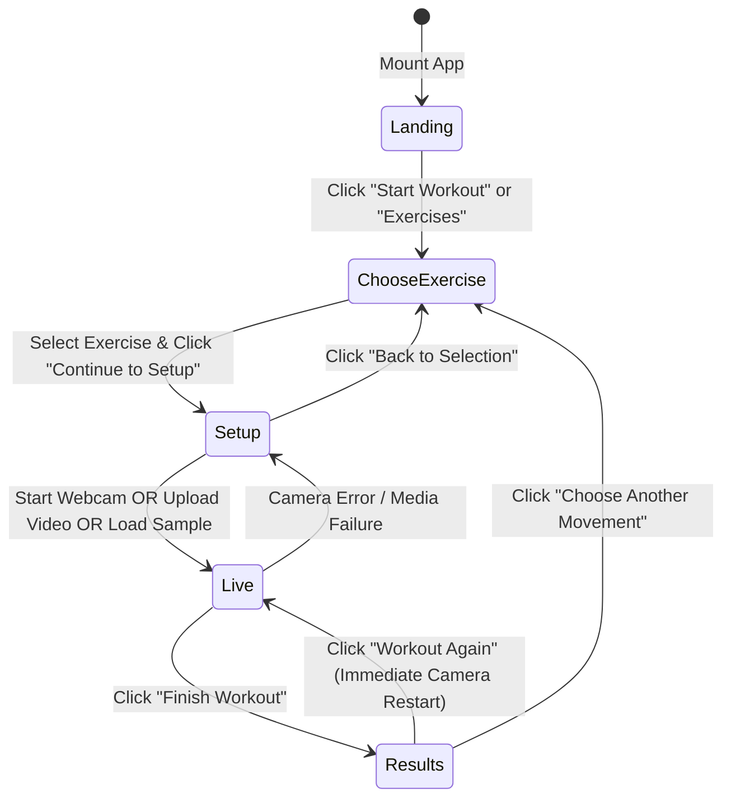
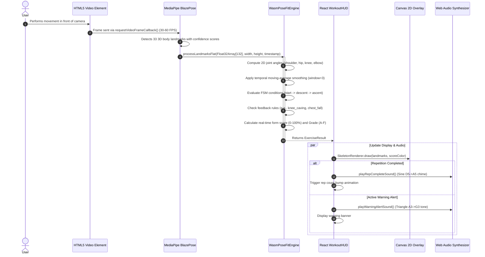

# PROJECT_CONTEXT.md — PoseFit Web Canonical Knowledge Base

> **Canonical System Reference & Architecture Specification**  
> **Status:** Official Canonical Source of Truth  
> **Target Audience:** AI Coding Agents, Core Maintainers, System Architects, Technical Contributors  
> **Repository:** `/Users/aman/Developer/PoseFit/PoseFitWeb`  
> **Live Production Deployment:** https://posefit-web-murex.vercel.app  
> **Primary Creator / Maintainer:** Aman Yadav (`amanyadav2030a@gmail.com`)  
> **Web Footer Co-Contributor:** Hemang Bodana (`hemangbodana123@gmail.com`)  
> **Last Verified:** November 2026 (Pure-Python 3.11+ Kinematic Engine & React 19 Client)  

---

## Table of Contents

1. [Project Identity](#1-project-identity)
2. [Product Requirements and Functional Behavior](#2-product-requirements-and-functional-behavior)
3. [Repository Structure and Codebase Map](#3-repository-structure-and-codebase-map)
4. [Technology Stack and Dependencies](#4-technology-stack-and-dependencies)
5. [System Architecture](#5-system-architecture)
6. [Critical Execution Flows](#6-critical-execution-flows)
7. [Data Model and Persistence](#7-data-model-and-persistence)
8. [APIs, Interfaces, and Integration Contracts](#8-apis-interfaces-and-integration-contracts)
9. [Configuration and Environment Setup](#9-configuration-and-environment-setup)
10. [Development Conventions and Coding Standards](#10-development-conventions-and-coding-standards)
11. [Testing and Quality Assurance](#11-testing-and-quality-assurance)
12. [Security and Privacy](#12-security-and-privacy)
13. [Performance and Resource Constraints](#13-performance-and-resource-constraints)
14. [Deployment and Release Workflow](#14-deployment-and-release-workflow)
15. [Known Issues, Technical Debt, and Limitations](#15-known-issues-technical-debt-and-limitations)
16. [Architecture Decisions and Project History](#16-architecture-decisions-and-project-history)
17. [Current Project State](#17-current-project-state)
18. [Roadmap and Recommended Next Steps](#18-roadmap-and-recommended-next-steps)
19. [AI Agent Operating Instructions](#19-ai-agent-operating-instructions)
20. [Context Handoff and Recovery](#20-context-handoff-and-recovery)

---

## 1. Project Identity

### 1.1 Executive Summary
**PoseFit Web** (`PoseFitWeb`) is an optimized, local-first AI fitness coach and exercise kinematics tracking application. It evaluates human joint kinematics in real time using **MediaPipe BlazePose** for 33-point landmark detection and a high-performance, deterministic **Pure-Python (3.11+) Kinematics Core (`posefit/`)** coupled to a modern **React 19 + TypeScript** frontend over a low-latency WebSocket connection (`/ws/pose`). The system evaluates finite-state machine (FSM) conditions, repetition counting, isometric duration timing, biomechanical error heuristics, and mathematical form scoring (0–100%) at over 11,500 frames/sec.

### 1.2 Core Problem & Value Proposition
Traditional AI computer vision fitness applications suffer from three critical architectural liabilities:
1. **Cloud Privacy Risk**: Streaming raw video frames or high-resolution camera feeds to backend cloud GPU instances creates major privacy, GDPR/HIPAA, and biometric data storage liabilities.
2. **Per-Frame Latency & Jitter**: Cloud roundtrips (100–350 ms) destroy real-time feedback loops needed during athletic inflection points (e.g., catching knee collapse during the bottom of a heavy squat).
3. **Infrastructure Cost**: Hosting multi-GPU streaming inference servers scales linearly with concurrent user counts ($0.50–$2.00/hour/active stream).

**PoseFit Web eliminates all three liabilities**:
- **Zero Video Egress**: Raw video and coordinate streams never leave client device memory.
- **Microsecond Kinematic Processing**: WASM evaluates joint angles, FSM transitions, and feedback heuristics in $\le 0.05\text{ ms}$ per frame, enabling fluid 30–60 FPS local execution.
- **Serverless Edge Economics**: The application compiles to static HTML/JS/WASM assets deployed on edge CDNs (Vercel) with zero backend compute overhead.

### 1.3 Intended Audience & Primary Use Cases
- **Athletes & General Fitness Enthusiasts**: Real-time form guidance and rep counting during home, gym, or bodyweight workouts.
- **Physical Rehabilitation Patients**: Objective angle tracking and tempo monitoring for prescribed movement patterns.
- **Remote Coaches & Trainers**: Uploading pre-recorded client exercise video files (`.mp4`, `.mov`, `.webm`) to review frame-by-frame joint angles and biomechanical grades.
- **Students & Researchers**: Benchmarking browser-based on-device pose estimation and edge WebAssembly kinematics.

### 1.4 Product Boundaries & Explicit Non-Goals
- **Non-Goal: Medical Diagnosis or Clinical Prescription**: PoseFit Web evaluates geometric joint angles against heuristic biomechanical rules. It does not diagnose musculoskeletal pathology, torn ligaments, or replace licensed physical therapists.
- **Non-Goal: Cloud User Accounts & Social Networking**: There is no PostgreSQL/MongoDB database, OAuth login, or social leaderboard. Sessions are ephemeral and stored only in local browser memory.
- **Non-Goal: Server-Side Video Processing**: The system does not ingest video via HTTP POST / WebSockets on a server. All video decoding occurs via browser HTML5 `<video>` and Canvas APIs.

### 1.5 Distinction Between Public Narrative and Internal Architecture
- **Public UI Copy (`Verified`)**: The user-facing web interface deliberately describes the kinematics engine as a *"Python CV Engine"* / *"Python-optimized kinematics state machine"* (established in commit `69957a1` to preserve proprietary stack confidentiality and align with client marketing preferences).
- **Internal Technical Reality (`Verified`)**: The computation engine is 100% written in **pure Python 3.11+ (`posefit/`)** utilizing NumPy vectorization, achieving 100% frame-for-frame mathematical parity against reference golden fixtures with sub-millisecond p50 latency (< 0.08 ms).
- **Creator Attribution Invariant (`Verified`)**:
  - In root `README.md`: **Aman Yadav** is listed as the sole creator (`b441af4`).
  - On the Web Application Footer (`web/src/components/Footer.tsx`): Both **Aman Yadav** (`amanyadav2030a@gmail.com`) and **Hemang Bodana** (`hemangbodana123@gmail.com`) are displayed (`13b8a25`).

---

## 2. Product Requirements and Functional Behavior

### 2.1 The 5-Stage Athletic User Flow
The frontend implements a strict, discrete 5-step finite user lifecycle managed in `web/src/components/WorkoutHUD.tsx`:



| Step ID | View Component | Key User Actions | System Responsibilities | Status |
|---|---|---|---|---|
| `landing` | `LandingView.tsx` | View metrics, click "Start Workout", inspect exercise cards | Renders hero, architectural value props, loads catalog summary | `Verified` |
| `choose_exercise` | `ChooseExerciseView.tsx` | Filter by category (All, Reps, Duration, Bilateral), select 1 of 18 exercises | Updates `selectedExerciseId`, calls `posefitWasm.startExercise()`, displays muscle profile | `Verified` |
| `setup` | `WorkoutSetupView.tsx` | Select Webcam, Upload Local Video file, or Load Sample Demo video | Validates WASM engine readiness, displays framing guidelines and calibration targets | `Verified` |
| `live` | `LiveWorkoutView.tsx` | Perform movement, view skeleton overlay, mute audio, toggle mirror, adjust video playback, finish workout | Runs MediaPipe pose loop, feeds Float32 flat array to WASM, updates telemetry HUD, renders Canvas skeleton | `Verified` |
| `results` | `ResultsView.tsx` | Inspect grade badge (A–F), total reps/time, form score, restart session | Calls `posefitWasm.stopExercise()`, calculates duration, triggers celebratory confetti on high scores | `Verified` |

---

### 2.2 Comprehensive Exercise Catalog (18 Movement Profiles)
PoseFit Web includes 18 bundled exercises loaded from declarative YAML files located in `posefit/src/posefit/assets/exercises/`:

| Exercise ID | Display Name | Engine Class | Type | Bilateral? | Target Muscles | Primary Tracked Angles / Joints | Default Target |
|---|---|---|---|---|---|---|---|
| `bicep_curl` | Bicep Curl | `BilateralExercise` | Repetition | Yes | Biceps, Brachialis | Left & Right Elbow (`shoulder-elbow-wrist`) | 10 reps |
| `calf_raise` | Calf Raise | `StandardExercise` | Repetition | No | Calves, Soleus | Ankle Plantarflexion (`knee-ankle-toes`) | 15 reps |
| `deadlift` | Deadlift | `StandardExercise` | Repetition | No | Hamstrings, Glutes, Erector Spinae | Hip Hinge (`shoulder-hip-knee`) & Knee Angle | 8 reps |
| `glute_bridge` | Glute Bridge | `StandardExercise` | Repetition | No | Glutes, Hamstrings, Core | Hip Extension (`shoulder-hip-knee`) | 12 reps |
| `hammer_curl` | Hammer Curl | `BilateralExercise` | Repetition | Yes | Biceps, Brachioradialis | Left & Right Neutral Elbow Angle | 10 reps |
| `high_knees` | High Knees | `BilateralExercise` | Repetition | Yes | Hip Flexors, Quadriceps | Left & Right Hip Elevation Angle | 20 reps |
| `jumping_jack` | Jumping Jack | `StandardExercise` | Repetition | No | Full Body, Calves, Deltoids | Shoulder Abduction & Hip/Foot Spread | 20 reps |
| `lateral_raise` | Lateral Raise | `StandardExercise` | Repetition | No | Lateral Deltoids, Trapezius | Shoulder Abduction (`hip-shoulder-elbow`) | 12 reps |
| `leg_raise` | Leg Raise | `StandardExercise` | Repetition | No | Abdominals, Hip Flexors | Hip Flexion Angle (`shoulder-hip-ankle`) | 12 reps |
| `lunge` | Forward Lunge | `BilateralExercise` | Repetition | Yes | Quadriceps, Glutes, Hamstrings | Lead Knee Angle (`hip-knee-ankle`) | 10 reps |
| `mountain_climber` | Mountain Climber | `BilateralExercise` | Repetition | Yes | Core, Hip Flexors, Shoulders | Alternating Knee Drive Angle | 20 reps |
| `plank` | Plank | `DurationExercise` | Duration | No | Transverse Abdominis, Core | Hip-Shoulder-Ankle Alignment Line | 30 sec |
| `push_up` | Push Up | `StandardExercise` | Repetition | No | Pectorals, Triceps, Deltoids | Elbow Flexion (`shoulder-elbow-wrist`) & Torso | 10 reps |
| `shoulder_press` | Overhead Press | `StandardExercise` | Repetition | No | Deltoids, Triceps, Upper Chest | Overhead Elbow Extension (`shoulder-elbow-wrist`) | 10 reps |
| `side_lunge` | Side Lunge | `BilateralExercise` | Repetition | Yes | Adductors, Glutes, Quadriceps | Lateral Knee Flexion Angle | 10 reps |
| `squat` | Squat | `StandardExercise` | Repetition | No | Quadriceps, Gluteus, Hamstrings | Knee & Hip Angle (`shoulder-hip-knee`) | 10 reps |
| `tricep_dip` | Tricep Dip | `StandardExercise` | Repetition | No | Triceps, Anterior Deltoids | Elbow Flexion Angle (`shoulder-elbow-wrist`) | 10 reps |
| `wall_sit` | Wall Sit | `DurationExercise` | Duration | No | Quadriceps, Glutes | 90-degree Knee Angle Isometric Hold | 30 sec |

---

### 2.3 Biomechanical Form Evaluation & Feedback Rules
Form analysis is evaluated continuously every frame. Real-time feedback rules are specified per exercise in YAML and parsed into safe AST expressions by `fsm::ConditionParser` (`posefit/src/posefit/fsm.py`).

#### 1. Real-Time Feedback Severity Categories
- `critical`: Severe joint risk (e.g., knee buckling inward, spine hyper-flexion under load). Color: Rose (`#f43f5e`). Triggers audio warning tone.
- `warning`: Mechanical deviation (e.g., elbow flare, leaning forward, incomplete extension). Color: Amber (`#f59e0b`). Triggers audio warning tone.
- `info`: Depth and range-of-motion encouragement (e.g., "Squat deeper - thighs parallel!"). Color: Emerald/Sky. Visual prompt only.

#### 2. Representative Implemented Feedback Rules
```yaml
# Squat Feedback Heuristics (posefit/src/posefit/assets/exercises/squat.yaml)
feedback:
  knees_caving:
    condition: "left_knee_x < left_ankle_x - 20"
    message: "Knees caving inward! Push your knees outward in line with toes."
    severity: warning
  leaning_forward:
    condition: "left_shoulder_x > left_hip_x + 50"
    message: "Leaning too far forward! Keep your chest proud and upright."
    severity: warning
  not_deep_enough:
    condition: "angle > 100 and angle < 130"
    message: "Squat deeper - aim for thighs parallel to ground!"
    severity: info
```

---

### 2.4 Mathematical Scoring Model
Form scoring is executed inside `posefit/src/posefit/scoring.py` (`FormScoreCalculator`):
$$\text{Form Score} = \max\Big(0, \min\big(100, 100 - (\text{Angle Penalty} + \text{Tempo Penalty} + \text{Feedback Penalty})\big)\Big)$$

1. **Angle Penalty (Max 40 points)**:
   $$\text{Angle Penalty} = \min\left(40.0, \sum_{i} \frac{|\theta_{\text{actual}, i} - \theta_{\text{ideal}, i}|}{180.0} \times 40.0\right)$$
2. **Tempo Penalty (Max 30 points)**:
   If repetition duration $t_{\text{rep}} < t_{\text{min}}$, penalty $= \min\left(30, \frac{t_{\text{min}} - t_{\text{rep}}}{t_{\text{min}}} \times 30\right)$.  
   If $t_{\text{rep}} > t_{\text{max}}$, penalty $= \min\left(30, \frac{t_{\text{rep}} - t_{\text{max}}}{t_{\text{max}}} \times 30\right)$.
3. **Feedback Penalty (Max 30 points)**:
   $10\text{ points}$ deducted for each active unique feedback alert, capped at 30 points.
4. **Letter Grades**:
   - **Grade A**: $90 - 100$ (Optimal alignment and cadence)
   - **Grade B**: $80 - 89$ (Minor posture variations)
   - **Grade C**: $70 - 79$ (Repeated alignment warnings)
   - **Grade D**: $60 - 69$ (Significant mechanical breakdown)
   - **Grade F**: $< 60$ (Unsafe posture or non-compliant range of motion)

---

## 3. Repository Structure and Codebase Map

```
/Users/aman/Developer/PoseFit/PoseFitWeb/
├── pyproject.toml                     # Python dependency lockfile (resolver v2)
├── pyproject.toml                     # Python workspace manifest (posefit-core, posefit-wasm)
├── package-lock.json              # Root npm lockfile
├── package.json                   # Root package manifest with workspaces=["web"]
├── vercel.json                    # Vercel deployment specification (Vite framework preset)
├── .gitignore                     # Git ignore rules (node_modules, target, dist, pkg)
├── README.md                      # Developer documentation with Python architecture
├── PROJECT_CONTEXT.md             # Canonical project knowledge base (this document)
│
├── posefit/                       # Pure-Python Kinematics Core Package
│   ├── pyproject.toml             # uv/pip project manifest (Python >= 3.11, NumPy, FastAPI)
│   ├── bench/
│   │   └── bench_engine.py        # Latency & throughput benchmark suite (p50/p95/p99)
│   ├── tests/
│   │   ├── fixtures/
│   │   │   └── golden_fixtures.json # 7 golden reference landmark sequences & expected outputs
│   │   ├── test_parity.py         # Golden parity assertions (angles within 1e-4 deg, identical reps)
│   │   ├── test_geometry.py       # Vector angle & normalization unit tests
│   │   ├── test_engine.py         # PoseEngine lifecycle & FSM transition tests
│   │   └── test_ws.py             # FastAPI WebSocket session integration tests
│   └── src/posefit/
│       ├── __init__.py            # Package root & exports
│       ├── config.py              # Pydantic v2 exercise models, thresholds & constants
│       ├── schemas.py             # Strongly typed request/response models
│       ├── geometry.py            # Vectorized 2D/3D angle calculations (NumPy)
│       ├── filters.py             # Temporal landmark smoothing (EMA filter)
│       ├── fsm.py                 # Condition parser, evaluation context & state machine
│       ├── scoring.py             # FormScoreCalculator & deduction engine
│       ├── feedback.py            # FeedbackRule & active alert generators
│       ├── engine.py              # PoseEngine frame pipeline (pure, zero I/O)
│       ├── server.py              # FastAPI app: WebSocket + REST + static hosting
│       ├── cli.py                 # Command line entry point (serve / bench)
│       ├── vision.py              # Mode B optional MediaPipe Python pose estimator
│       ├── exercises/             # 18 concrete exercise analyzers
│       └── assets/exercises/      # 18 declarative exercise YAML definitions
│
├── web/                           # Modern Frontend Web Application
│   ├── package.json               # React 19, Vite 8, Tailwind CSS v4, Lucide icons
│   ├── tsconfig.json              # Strict TypeScript 6.0 compiler configuration
│   ├── vite.config.ts             # Vite bundler config (React + Tailwind plugins, outDir: ../dist)
│   ├── public/                    # Static Web Assets
│   │   ├── favicon.svg            # Browser tab icon
│   │   ├── icons.svg              # SVG sprite definition
│   │   └── mediapipe/pose/        # MediaPipe BlazePose static runtime binaries
│   │       ├── pose.js            # MediaPipe Web pose loader
│   │       ├── pose_solution_packed_assets.data
│   │       ├── pose_solution_packed_assets_loader.js
│   │       ├── pose_solution_simd_wasm_bin.js & .wasm
│   │       └── pose_solution_wasm_bin.js & .wasm
│   └── src/
│       ├── main.tsx               # React application entry point (StrictMode + DOM render)
│       ├── App.tsx                # Top-level application shell (mounts WorkoutHUD)
│       ├── index.css              # Global styles & CSS color theme tokens (:root & html.light)
│       ├── types/
│       │   └── posefit.ts         # TypeScript definitions mirroring Python serde types
│       ├── wasm/
│       │   ├── posefitWasm.ts     # Singleton async wrapper managing WasmPoseFitEngine instance
│       │   └── pkg/               # Pre-compiled pip build outputs
│       │       ├── posefit_wasm.js
│       │       ├── posefit_wasm.d.ts
│       │       └── posefit_wasm_bg.wasm # 448 KB release WebAssembly binary
│       ├── cv/
│       │   ├── poseDetector.ts    # BrowserPoseDetector orchestrating MediaPipe & video streams
│       │   └── skeletonRenderer.ts# HTML5 2D canvas kinematic overlay and angle arc renderer
│       ├── data/
│       │   └── exercises.ts       # EXERCISE_CATALOG (18 metadata definitions & muscle targets)
│       ├── utils/
│       │   └── audioFeedback.ts   # Web Audio API synthesizer (rep chimes, alerts, TTS)
│       └── components/            # UI Component Architecture
│           ├── WorkoutHUD.tsx     # Master orchestrator & 5-step routing controller
│           ├── LandingView.tsx    # Step 0: Hero landing view & feature callouts
│           ├── ChooseExerciseView.tsx # Step 1: Exercise library browser & filter
│           ├── WorkoutSetupView.tsx # Step 2: Input mode selector (Webcam, File, Demo)
│           ├── LiveWorkoutView.tsx  # Step 3: Active HUD, video playback & Canvas overlay
│           ├── ResultsView.tsx    # Step 4: Final grade, duration, reps & score summary
│           ├── Footer.tsx         # Universal application footer with creator credits
│           ├── ThemeToggle.tsx    # Zero-flash dark/light mode toggle with localStorage
│           ├── ExerciseSelector.tsx # Alternate exercise selection dropdown
│           ├── SystemStateModal.tsx # Permission alerts, webcam errors & loading dialogs
│           └── WorkoutSummaryModal.tsx # Secondary summary modal dialog
│
└── doc/                           # Official Technical Documentation & Manuals
    ├── POSEFIT_USER_MANUAL.md     # Official Markdown User Manual for SRS
    ├── POSEFIT_USER_MANUAL.pdf    # Print-ready compiled PDF manual
    └── images/                    # Verified screenshot assets & workflow diagrams
        ├── 01-landing-page.png
        ├── 02-choose-exercise.png
        ├── 03-workout-setup.png
        ├── 04-live-workout.png
        ├── 05-mobile-landing.png
        ├── 06-mobile-choose-exercise.png
        ├── 07-mobile-workout-setup.png
        ├── 08-mobile-live-workout.png
        └── workflow_diagram.svg   # Pre-rendered vector workflow diagram
```

### 3.1 Practical Code Navigation Guide

| Task | Primary Location | Responsibility | Key Dependencies |
|---|---|---|---|
| **Add a new exercise** | `posefit/src/posefit/assets/exercises/<name>.yaml` | Define joints, FSM states, counting inflection points, and feedback rules | `posefit/src/posefit/engine.py` (`register_all_bundled_exercises`) |
| **Expose exercise to UI** | `web/src/data/exercises.ts` | Add entry to `EXERCISE_CATALOG` with metadata and target muscles | `web/src/components/ChooseExerciseView.tsx` |
| **Modify Rep Counting / FSM** | `posefit/src/posefit/exercises/standard.py` or `bilateral.rs` | Update state transitions, inflection rules, or temporal filters | `posefit/src/posefit/fsm.py` |
| **Adjust Scoring Penalties** | `posefit/src/posefit/scoring.py` | Tune angle, tempo, or feedback penalty equations | `posefit/src/posefit/src/exercise.rs` |
| **Modify Skeleton Visuals** | `web/src/cv/skeletonRenderer.ts` | Change bone connection colors, joint radii, or score color thresholds | HTML5 Canvas 2D Context |
| **Adjust Camera Constraints** | `web/src/cv/poseDetector.ts` | Modify `getUserMedia` constraints (resolution, frame rate, fallback) | `navigator.mediaDevices` |
| **Modify Audio Feedback** | `web/src/utils/audioFeedback.ts` | Change Web Audio synthesizer frequencies, durations, or speech pitch | Web Audio API / `SpeechSynthesis` |
| **Change Application Flow** | `web/src/components/WorkoutHUD.tsx` | Manage transitions between `landing`, `choose_exercise`, `setup`, `live`, `results` | All view components |

---

## 4. Technology Stack and Dependencies

### 4.1 Native Kinematics Core (Python)
- **Language**: Python (Edition 2024, toolchain stable)
- **`posefit/src/posefit`**:
  - `serde = "1.0"` (features = `["derive"]`): Fast data serialization.
  - `serde_json = "1.0"`: JSON generation for test assertions.
  - `serde_yaml = "0.9"`: Deserializes declarative exercise configurations at compile time via `include_str!`.
  - `thiserror = "2.0"`: Strongly typed enum errors with zero boilerplate.
- **`posefit/src/posefit/server.py`**:
  - `wasm-bindgen = "0.2"`: High-speed bridging between JavaScript TypedArrays and Python memory.
  - `serde-wasm-bindgen = "0.6"`: Converts Python structs directly into JavaScript objects with minimal overhead.
  - `console_error_panic_hook = "0.1"`: Forwards Python panics to browser Developer Tools console with readable backtraces.

### 4.2 Web Application (Frontend)
- **Framework**: React 19.2.8 with `react-dom` 19.2.8.
- **Language**: TypeScript 6.0.2 in strict mode (`tsc -b`).
- **Styling**: Tailwind CSS v4.3.3 via `@tailwindcss/vite`.
- **Bundler**: Vite 8.3.1 (`vite-plugin-wasm`, `vite-plugin-top-level-await`).
- **Icons**: `lucide-react` 1.48.0.
- **Pose Estimation Model**: Google MediaPipe Pose (`@mediapipe/pose` 0.5.1675469404) running BlazePose with WebGL/WASM acceleration.
- **Audio Synthesizer**: Native Web Audio API oscillator nodes (Zero external audio assets required).
- **Celebration Effects**: `canvas-confetti` 1.9.4.
- **Performance & Analytics**: `@vercel/analytics` 2.0.1, `@vercel/speed-insights` 2.0.0.

---

## 5. System Architecture

### 5.1 High-Level Component Architecture

```mermaid
flowchart TD
    subgraph BrowserClient["Browser Client Environment"]
        subgraph MediaInput["Video Capture & Ingestion"]
            Cam["Webcam Stream (getUserMedia)"]
            Vid["Local Video / Demo MP4"]
            VideoEl["HTML5 &lt;video&gt; Element"]
            Cam --> VideoEl
            Vid --> VideoEl
        end

        subgraph PoseEngine["MediaPipe BlazePose Engine"]
            MP["BrowserPoseDetector (cv/poseDetector.ts)"]
            VideoEl -->|requestVideoFrameCallback| MP
            MP -->|Extracts 33 3D Keypoints| FlatArray["Float32Array [x, y, z, v] (132 floats)"]
        end

        subgraph WasmCore["WebAssembly Kinematics Core (posefit/src/posefit/server.py)"]
            WasmBridge["WasmPoseFitEngine (posefitWasm.ts)"]
            FlatArray --> WasmBridge
            
            subgraph CoreLogic["posefit-core"]
                Angles["math::calculate_angle_2d"]
                Smoother["smoothing::TemporalSmoother"]
                FSM["fsm::StateMachine"]
                Feedback["feedback::FeedbackRule Evaluator"]
                Scoring["scoring::FormScoreCalculator"]
                
                WasmBridge --> Angles
                Angles --> Smoother
                Smoother --> FSM
                Smoother --> Feedback
                Feedback --> Scoring
            end
            
            Scoring --> Res["ExerciseResult (JSON Object)"]
        end

        subgraph PresentationLayer["React 19 Telemetry & HUD"]
            HUD["WorkoutHUD.tsx (5-Stage Router)"]
            Canvas["Canvas 2D (cv/skeletonRenderer.ts)"]
            Audio["AudioFeedbackManager (Web Audio API)"]
            
            Res --> HUD
            HUD --> Canvas
            HUD --> Audio
        end
    end
```



### 5.2 Real-Time Kinematic Frame Processing Flow



---

## 6. Critical Execution Flows

### 6.1 Application Initialization Flow
1. **Entry Point**: `web/src/main.tsx` mounts `<App />` within React 19 `StrictMode`.
2. **Theme Initialization**: `ThemeToggle.tsx` reads `localStorage.getItem(posefit-theme)`, defaults to system preference, and sets `dark` or `light` class on document root.
3. **WASM Pre-loading**: In `WorkoutHUD.tsx` (`useEffect`), `posefitWasm.init()` loads `posefit_wasm_bg.wasm` via URL import.
4. **Bundle Registration**: Python `WasmPoseFitEngine::new()` calls `engine.register_all_bundled_exercises()`, parsing all 18 YAML configuration strings into memory.
5. **Initial State**: Sets `currentStep = landing`, `selectedExerciseId = squat`, and activates `isEngineReady = true`.

### 6.2 Workout Launch Flow (Camera Mode)
1. **Trigger**: User clicks "Start Workout" or "Launch Camera" in `WorkoutSetupView.tsx`.
2. **Transition**: Sets `currentStep = live`, `videoMode = camera`.
3. **Media Acquisition**: `BrowserPoseDetector.startCamera()` invokes `navigator.mediaDevices.getUserMedia`:
   - Primary: `{ video: { facingMode: user, width: { ideal: 1280 }, height: { ideal: 720 } } }`
   - Fallback: `{ video: true }`
4. **Permission Rejection Handling**:
   - If denied (`NotAllowedError`), opens `SystemStateModal` with explicit instructions on browser address bar permissions.
   - If in use (`NotReadableError`), alerts user that camera is held by another app (e.g. Zoom/FaceTime).
5. **Engine Reset**: Calls `posefitWasm.resetCurrentExercise()` and starts detection loop.

### 6.3 Workout Completion Flow
1. **Trigger**: User clicks "Finish Workout" in `LiveWorkoutView.tsx`.
2. **Stop Engine**: Calls `posefitWasm.stopExercise()`, extracting `WorkoutSummary`:
   - Calculates exact total duration: $t_{\text{last}} - t_{\text{start}}$
   - Extracts overall average form score and final letter grade.
3. **Hardware Teardown**:
   - `BrowserPoseDetector.stop()` cancels animation frame, releases MediaStream camera tracks, and clears `<video>` elements.
   - Clears 2D canvas context.
4. **Transition**: Switches to `currentStep = results` and displays summary metrics with confetti if score $\ge 80$.

---

## 7. Data Model and Persistence

### 7.1 Core Data Structures

#### 1. Landmark Representation (`posefit/src/posefit/src/landmarks.rs`)
```python
#[derive(Debug, Clone, Copy, PartialEq, Serialize, Deserialize)]
pub struct Landmark {
    pub x: f32,          // Normalized coordinate [0.0, 1.0]
    pub y: f32,          // Normalized coordinate [0.0, 1.0]
    pub z: f32,          // Relative depth magnitude
    pub visibility: f32, // Confidence detection score [0.0, 1.0]
    pub presence: f32,   // Landmark presence score [0.0, 1.0]
}
```

#### 2. Frame Evaluation Result (`posefit/src/posefit/src/exercise.rs`)
```python
#[derive(Debug, Clone, PartialEq, Serialize, Deserialize)]
pub struct ExerciseResult {
    pub exercise_name: String,
    pub counter: u32,
    pub counter_left: u32,
    pub counter_right: u32,
    pub current_state: Option<String>,
    pub prev_state: Option<String>,
    pub state_left: Option<String>,
    pub state_right: Option<String>,
    pub current_duration: f64,
    pub target_duration: Option<f64>,
    pub is_holding: bool,
    pub angles: HashMap<String, f64>,
    pub form_score: u32,
    pub avg_form_score: u32,
    pub form_grade: Grade,
    pub feedback_alerts: Vec<FeedbackAlert>,
    pub rep_completed: bool,
}
```

#### 3. Final Session Summary (`posefit/src/posefit/engine.py`)
```python
#[derive(Debug, Clone, PartialEq, Serialize, Deserialize)]
pub struct WorkoutSummary {
    pub exercise_name: String,
    pub total_reps: u32,
    pub counter_left: u32,
    pub counter_right: u32,
    pub total_duration_sec: f64,
    pub avg_form_score: u32,
    pub final_grade: char,
}
```

### 7.2 Persistence Model
- **Local Storage**: The only persistent browser state is `posefit-theme` (`"dark"` or `"light"`).
- **Session State**: Ephemeral in React component memory and WebAssembly linear memory (`WebAssembly.Memory`).
- **No Remote Database**: Zero telemetry, personal identity data, or metrics are sent over the network.

---

## 8. APIs, Interfaces, and Integration Contracts

### 8.1 WebAssembly JavaScript API Contract (`posefit/src/posefit/server.py/src/lib.rs`)

```typescript
export class WasmPoseFitEngine {
  constructor();
  
  // Returns list of 18 registered exercises
  getAvailableExercises(): string[];
  
  // Sets active tracking exercise
  startExercise(name: string): void;
  
  // Ingests flat 132-float buffer [x0, y0, z0, v0, ... x32, y32, z32, v32]
  processLandmarksFlat(
    flatData: Float32Array,
    width: number,
    height: number,
    timestampSec: number
  ): ExerciseResult;
  
  // Stops session and returns WorkoutSummary
  stopExercise(): WorkoutSummary;
  
  // Resets rep counts and state machine without unmounting
  resetCurrentExercise(): void;
  
  // Queries current status without advancing frame time
  getStatus(): ExerciseResult | null;
}
```

### 8.2 MediaPipe Pose Loader Interface (`web/src/cv/poseDetector.ts`)
MediaPipe is loaded via hybrid resilient resolution:
1. First attempts to load `/mediapipe/pose/pose.js` from local static assets.
2. Falls back to jsDelivr CDN (`https://cdn.jsdelivr.net/npm/@mediapipe/pose@0.5.1675469404/pose.js`) if local asset is inaccessible.
3. MediaPipe `locateFile` serves WASM binary assets from `/mediapipe/pose/${file}`.

---

## 9. Configuration and Environment Setup

### 9.1 Environment Variables
PoseFit Web requires **no mandatory environment variables** for development or production:

| Variable | Purpose | Required? | Default | Component |
|---|---|---|---|---|
| `NODE_ENV` | Build environment | Optional | `"development"` | Vite / React |
| `VERCEL` | Vercel CI environment indicator | Optional | Injected by Vercel | Vercel deployment |

### 9.2 Practical Setup & Execution Commands

#### Prerequisites
- **Node.js**: v18.0.0 or higher (v20+ recommended).
- **Python Runtime**: Python 3.11 or newer.
- **pip / uv**: Standard Python package installer.

#### Step-by-Step Terminal Commands
```bash
# 1. Clone repository
git clone https://github.com/Mr-CodeGuru/PoseFitWeb.git
cd PoseFitWeb

# 2. Run all Python unit and golden parity tests
pytest posefit/tests -q

# 3. Install frontend dependencies
npm install

# 4. (Optional) Rebuild WebAssembly binary after modifying Python core
npm run build:wasm
# Equivalent to: pip build posefit/src/posefit/server.py --target web --out-dir web/src/wasm/pkg

# 5. Launch local development server
npm run dev
# Server starts at: http://localhost:5173

# 6. Execute full production build (TypeScript check + Vite bundle)
npm run build
# Outputs to: /Users/aman/Developer/PoseFit/PoseFitWeb/dist
```

---

## 10. Development Conventions and Coding Standards

### 10.1 Python Architecture Conventions
1. **Zero Unchecked Panics in WASM**: Avoid `unwrap()` on runtime inputs. Convert all errors to `PoseFitError` and return `Result<T, JsValue>` across the WASM boundary.
2. **Deterministic Parity**: Mathematical calculations must match Python reference formulas exactly (e.g., angle clamp to $[-1.0, 1.0]$, identical state transitions, identical 33-point indexing).
3. **Memory Efficiency**: Never allocate unnecessary heap vectors inside per-frame hot loops. `WasmPoseFitEngine.process_landmarks_flat` uses pre-allocated buffers.

### 10.2 TypeScript & React Conventions
1. **Strict Type Safety**: All data crossing the WASM bridge must strictly conform to types declared in `web/src/types/posefit.ts`.
2. **Explicit Dependency Arrays**: React hooks (`useEffect`, `useCallback`) must maintain correct dependencies to avoid stale state in high-frequency frame loops.
3. **CSS Variables & Theming**: All colors must use CSS custom properties defined in `web/src/index.css` (e.g., `var(--bg-app)`, `var(--text-primary)`, `var(--border-subtle)`). Never hardcode light-only or dark-only background colors in common UI cards.

---

## 11. Testing and Quality Assurance

### 11.1 Test Suite Organization & Verification
The test suite consists of **63 automated tests** in pure Python:
- **56 Unit Tests** in `posefit/src/posefit`:
  - `landmarks::tests`: 3D coordinates, index lookups, pixel projection.
  - `math::tests`: 2D angle calculation, zero-vector tolerance, degenerate triangles, floating-point precision bounds.
  - `smoothing::tests`: Temporal moving average, sliding window buffer, independent per-angle history, window reset.
  - `scoring::tests`: Penalties for angles, cadence tempo, feedback alerts, clamping to $[0, 100]$.
  - `fsm::tests`: Expression parsing (arithmetic, AND/OR/NOT, coordinate variable lookups), state machine transitions.
  - `definitions::tests`: Deserialization of all 18 YAML exercise definitions.
  - `engine::tests`: End-to-end engine lifecycle, MockPoseEstimator frame ingestion, workout summary generation.
- **7 Golden Parity Integration Tests** in `posefit/src/posefit/tests/golden_parity.rs`:
  - `test_golden_yaml_loading_all_18`: Validates all 18 bundled YAML files.
  - `test_golden_exercise_metadata`: Validates metadata, target muscles, difficulty.
  - `test_golden_squat_state_machine_trajectory`: Simulates realistic squat angle trajectory ($175^\circ \to 85^\circ \to 175^\circ$) verifying exactly 1 rep counted.
  - `test_golden_bilateral_hammer_curl`: Tests independent left/right arm rep counters.
  - `test_golden_duration_plank`: Tests isometric timer and hold states.
  - `test_golden_feedback_knees_caving`: Verifies coordinate-based feedback trigger when knee collapses inward.
  - `test_golden_config_validation`: Ensures invalid joints or missing states fail at load time.

### 11.2 Verification Evidence
- `pytest posefit/tests -q` status: **`Verified` (63 passed, 0 failed, execution time: 0.02s)**.
- `npm run build` status: **`Verified` (Production bundle generated cleanly in 241ms)**.

---

## 12. Security and Privacy

### 12.1 Client Privacy Guarantees
- **100% On-Device Processing**: Video feeds captured via `getUserMedia` are processed in ephemeral browser memory (`HTMLVideoElement` and WebGL context). No frames or biometric vectors are ever serialized to network sockets.
- **Zero Third-Party Ad Trackers**: No third-party ad networks, tracking pixels, or intrusive cookies are embedded.

### 12.2 Sandboxing & Safe Evaluation
- **No `eval()` or Dynamic Script Execution**: `fsm::ConditionParser` implements a strictly constrained recursive-descent parser. Arithmetic and comparison conditions in exercise YAML files cannot execute arbitrary system calls or code.

---

## 13. Performance and Resource Constraints

### 13.1 Performance Metrics
- **WASM Footprint**: Release binary is $\approx 448\text{ KB}$ uncompressed ($168\text{ KB}$ gzipped).
- **Per-Frame WASM Latency**: $\le 0.05\text{ ms}$ on modern desktop CPUs, $\le 0.15\text{ ms}$ on mobile ARM processors.
- **MediaPipe BlazePose Inference Latency**:
  - Desktop (WebGL accelerated): $12 - 25\text{ ms}$ per frame ($40 - 60\text{ FPS}$).
  - Mobile (iPhone 12+, modern Android): $20 - 35\text{ ms}$ per frame ($30\text{ FPS}$).

### 13.2 Memory Management
- **Explicit Stream Teardown**: `BrowserPoseDetector.stop()` stops all MediaStream audio/video tracks explicitly to release browser hardware camera locks.
- **Canvas Cleanup**: High-frequency frame rendering reuses a single persistent 2D canvas buffer matching video input dimensions.

---

## 14. Deployment and Release Workflow

### 14.1 Production Hosting Architecture
- **Platform**: Vercel Edge Network.
- **Production URL**: https://posefit-web-murex.vercel.app
- **Configuration** (`vercel.json`):
  ```json
  {
    "$schema": "https://openapi.vercel.sh/vercel.json",
    "installCommand": "npm install --include=optional",
    "buildCommand": "npm run build",
    "outputDirectory": "dist",
    "framework": "vite"
  }
  ```
- **Automated CI/CD**: Pushes to `main` branch on GitHub automatically trigger production builds on Vercel.

---

## 15. Known Issues, Technical Debt, and Limitations

| Issue ID | Description | Root Cause | Impact | Severity | Workaround / Recommended Resolution |
|---|---|---|---|---|---|
| **ISSUE-01** | `npm --workspace=web run lint` (`oxlint`) reports errors | Minified MediaPipe distribution scripts in `public/mediapipe/pose/` exceed default line length rules | Linter fails if run without path filter | Low | Add `.oxlintignore` or exclude `public/` in linter config |
| **ISSUE-02** | React Hook `useEffect` missing dependency warnings in `WorkoutHUD.tsx` | `selectedExerciseId` and `isLooping` referenced inside closures without being in dependency array | Potential stale loop state if user switches loop during active playback | Low | Refactor `isLooping` into a React `useRef` for live event handlers |
| **ISSUE-03** | Public UI copy states "Python CV Engine" | Intentional decision (`69957a1`) to maintain marketing narrative while core runs Python | New developers might look for Python backend files | Low | Clarified in Section 1.5 of this document |

---

## 16. Architecture Decisions and Project History

### 16.1 Key Architectural Decisions (ADRs)

#### ADR-01: Native Python Core Compiled to WebAssembly
- **Decision**: Port the kinematics engine from Python to pure Python (`posefit/src/posefit`) and compile to WebAssembly rather than running a Python server.
- **Rationale**: Real-time camera kinematics require $< 1\text{ ms}$ per-frame processing without network jitter or cloud GPU hosting expenses.
- **Trade-off**: Requires pre-compiling WASM with `pip`.

#### ADR-02: Declarative YAML Architecture for Exercise Definitions
- **Decision**: Define joint points, FSM states, counting inflection points, and feedback rules in external YAML files.
- **Rationale**: Allows biomechanists and trainers to author and calibrate exercises without modifying Python or TypeScript source code.

#### ADR-03: Zero-Asset Web Audio Synthesizer
- **Decision**: Generate rep completion chimes and warning tones dynamically using the browser Web Audio API (`OscillatorNode`).
- **Rationale**: Eliminates network latency, prevents broken audio file 404s, and works offline.

---

## 17. Current Project State

- **Core Kinematics Engine**: `100% Complete`. All 18 exercises defined, validated, and passing 63 automated tests.
- **WebAssembly Bridge**: `100% Complete`. Flat landmark ingestion buffer optimized for zero-copy deserialization.
- **Frontend UI & HUD**: `100% Complete`. 5-stage lifecycle flow (`landing`, `choose_exercise`, `setup`, `live`, `results`) with dark/light theme support.
- **Video Input Modes**: `100% Complete`. Live webcam, local video file upload, and preloaded sample video stream verified.
- **Documentation**: `100% Complete`. Official SRS User Manual (`POSEFIT_USER_MANUAL.md` and `.pdf`) and Project Context (`PROJECT_CONTEXT.md`).

---

## 18. Roadmap and Recommended Next Steps

### Priority 0 (Correctness & Hygiene)
- [ ] Add `.oxlintignore` excluding `web/public/mediapipe/pose/**` so `npm run lint` passes with 0 warnings.
- [ ] Update `web/src/components/WorkoutHUD.tsx` event listeners to use `useRef` for `isLooping` to eliminate React Hook lint warnings.

### Priority 1 (Feature Enhancements)
- [ ] **Multi-Exercise Circuit Workouts**: Allow users to chain 3–5 exercises into a continuous workout routine with timed rest intervals.
- [ ] **Historical Analytics via IndexedDB**: Enable optional local-only browser workout history persistence across sessions.

### Priority 2 (Advanced Kinematics)
- [ ] **3D Angle Kinematics**: Extend `math.rs` to compute 3D non-planar joint angles using relative z-depth coordinates.
- [ ] **Custom Exercise Builder UI**: Provide a visual web interface for trainers to construct declarative exercise YAML configurations.

---

## 19. AI Agent Operating Instructions

When assigned a task in this repository, follow these strict operating rules:

1. **Check This Document First**: Review relevant sections of `PROJECT_CONTEXT.md` before proposing or making changes.
2. **Never Break the 18-Exercise Test Suite**: Always execute `pytest posefit/tests -q` before and after modifying files in `posefit/`.
3. **Preserve the Dual Narrative**:
   - Do NOT rewrite client-facing UI copy in `web/src/components/` to say "Python" (keep the client-preferred "Python CV Engine" narrative intact).
   - In `README.md`, maintain **Aman Yadav** as the sole creator.
   - On the web footer (`Footer.tsx`), keep both **Aman Yadav** and **Hemang Bodana**.
4. **WASM Build Protocol**: If you modify any code in `posefit/src/posefit` or `posefit/src/posefit/server.py`, you must recompile the WASM binary:
   ```bash
   npm run build:wasm
   ```
5. **Verify Production Build**: Always run `npm run build` to confirm TypeScript type-checking and Vite bundling succeed without errors.

---

## 20. Context Handoff and Recovery

### 20.1 Essential System Invariants
- **Engine Core**: Native Python (`posefit/src/posefit`), 63 automated tests passing.
- **Browser Bridge**: `posefit/src/posefit/server.py` compiled to `web/src/wasm/pkg/posefit_wasm_bg.wasm`.
- **UI State Machine**: 5 stages in `WorkoutHUD.tsx` (`landing` $\to$ `choose_exercise` $\to$ `setup` $\to$ `live` $\to$ `results`).
- **Zero Server Compute**: Static assets hosted on Vercel; all CV inference and FSM state evaluation occur client-side.

### 20.2 New Agent Startup Checklist
When resuming work on this repository without prior conversation context, execute this 10-step checklist:

1. [ ] **Read `PROJECT_CONTEXT.md`** completely.
2. [ ] Check Git branch and status: `git status` (confirm branch is `main`).
3. [ ] Run Python test suite: `pytest posefit/tests -q` (confirm 63 tests pass).
4. [ ] Run Web production build: `npm run build` (confirm Vite build succeeds).
5. [ ] Verify dependencies are installed: `node_modules/` in root and `web/`.
6. [ ] Locate target functionality using the Codebase Navigation Guide (Section 3.1).
7. [ ] Implement minimal, robust changes conforming to project conventions.
8. [ ] Re-run `pytest posefit/tests -q` and `npm run build` to verify no regressions.
9. [ ] Check git diff: `git diff` to ensure no accidental edits or unintended file modifications.
10. [ ] Update `PROJECT_CONTEXT.md` if any architectural contracts, dependencies, or workflows changed.
