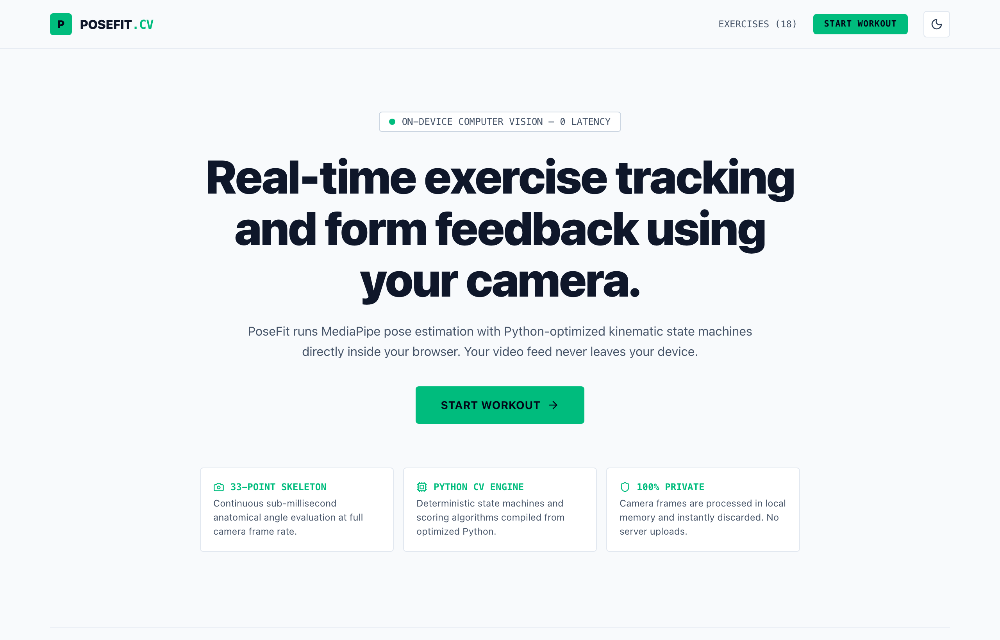
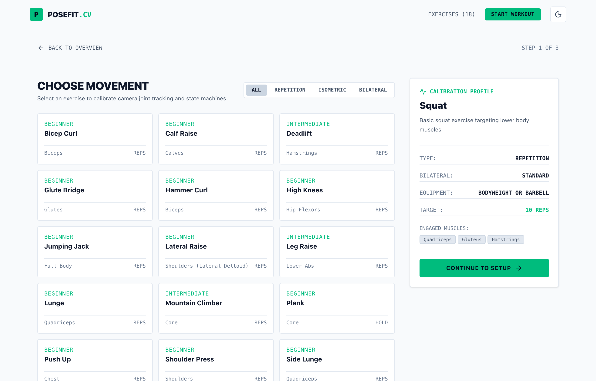
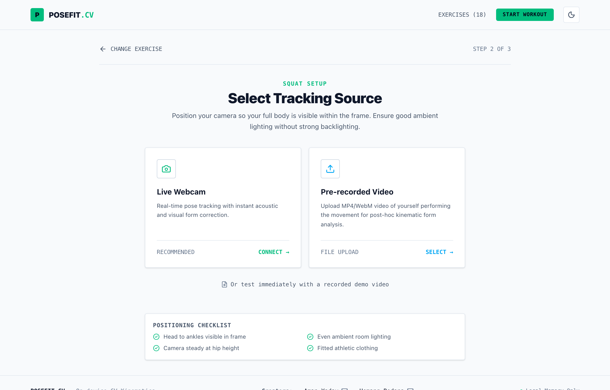
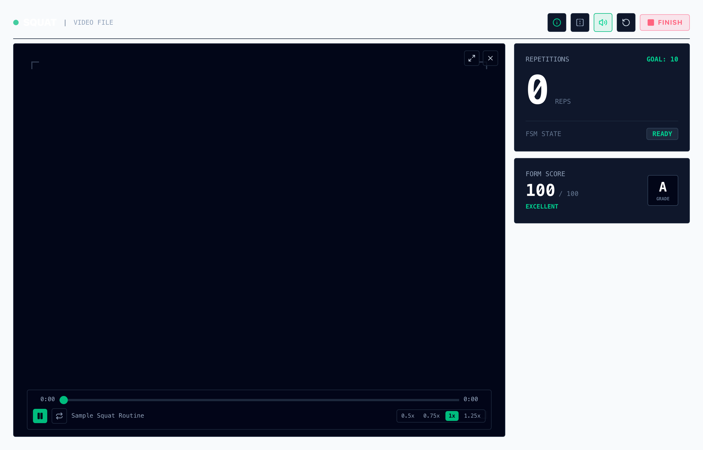
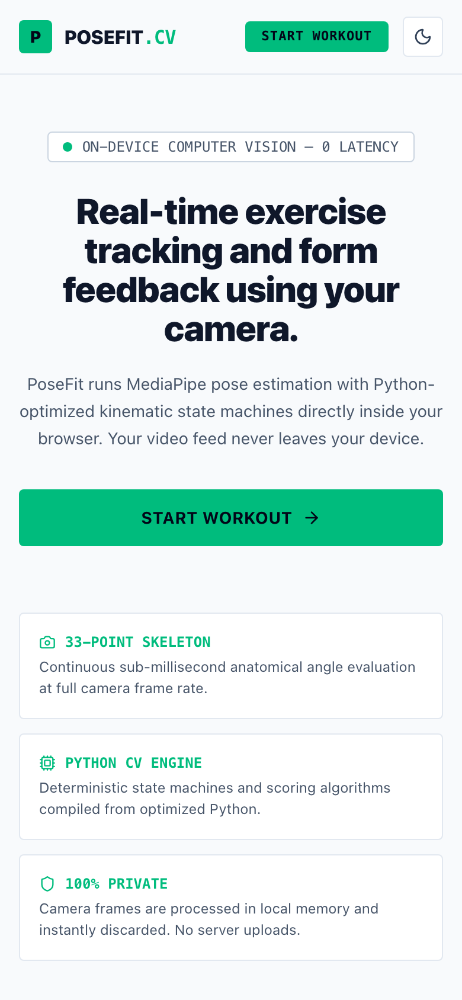
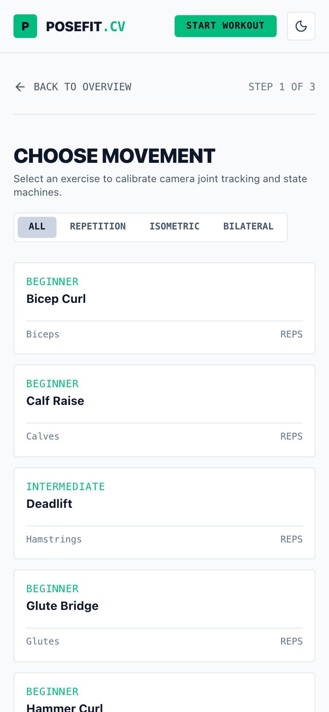
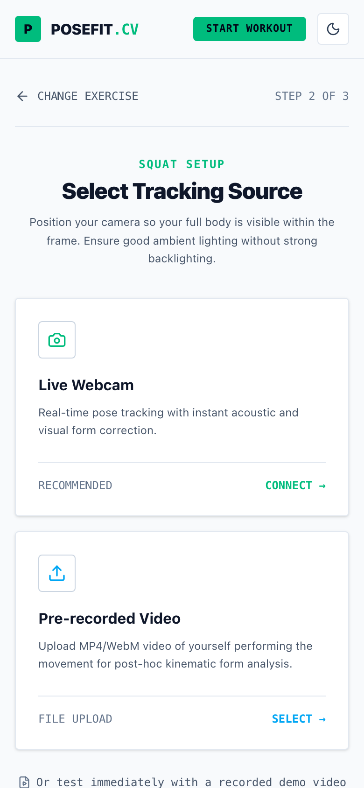
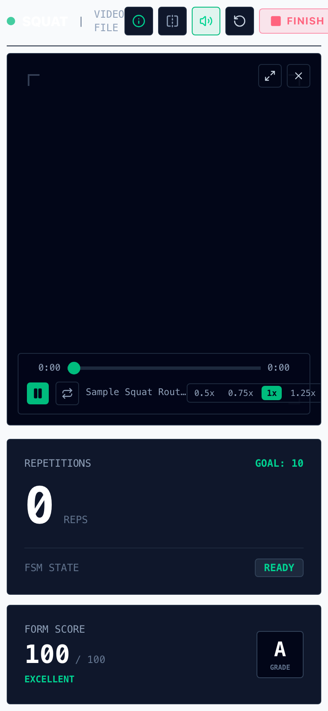
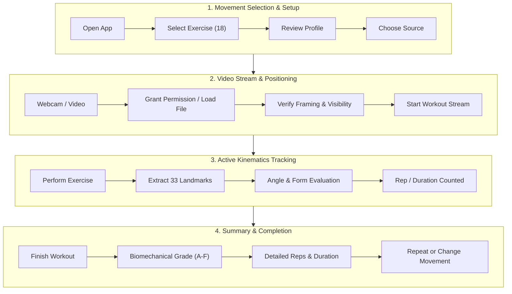

# PoseFit Web — User Manual

| Field | Information |
|---|---|
| Application | PoseFit Web |
| Document | User Manual |
| Document Type | User Documentation |
| Application URL | [https://posefit-web-murex.vercel.app](https://posefit-web-murex.vercel.app) |
| Version | Current Web Version |
| Status | Official Project Documentation |
| Last Updated | October 2, 2026 |

---

## Table of Contents

1. [Introduction](#1-introduction)
   - 1.1 [Purpose of This Manual](#11-purpose-of-this-manual)
   - 1.2 [Intended Audience](#12-intended-audience)
   - 1.3 [Product Overview](#13-product-overview)
   - 1.4 [Scope](#14-scope)
2. [System Requirements](#2-system-requirements)
3. [Getting Started](#3-getting-started)
   - 3.1 [Accessing the Website](#31-accessing-the-website)
   - 3.2 [Initial Application Load](#32-initial-application-load)
   - 3.3 [Permissions and Device Access](#33-permissions-and-device-access)
4. [User Interface Overview](#4-user-interface-overview)
5. [Navigation](#5-navigation)
6. [Step-by-Step Exercise Workflow](#6-step-by-step-exercise-workflow)
   - 6.1 [Step 1: Application Landing & Overview](#61-step-1-application-landing--overview)
   - 6.2 [Step 2: Choose Movement & Calibration Profile](#62-step-2-choose-movement--calibration-profile)
   - 6.3 [Step 3: Tracking Source & Positioning Setup](#63-step-3-tracking-source--positioning-setup)
   - 6.4 [Step 4: Live Workout & Real-Time Telemetry](#64-step-4-live-workout--real-time-telemetry)
   - 6.5 [Step 5: Session Completion & Results](#65-step-5-session-completion--results)
7. [Camera and Positioning](#7-camera-and-positioning)
   - 7.1 [Camera Permission](#71-camera-permission)
   - 7.2 [Camera Placement](#72-camera-placement)
   - 7.3 [User Position](#73-user-position)
   - 7.4 [Lighting](#74-lighting)
   - 7.5 [Background and Apparel](#75-background-and-apparel)
8. [Pose Detection and Exercise Tracking](#8-pose-detection-and-exercise-tracking)
9. [Repetition and Duration Counting](#9-repetition-and-duration-counting)
10. [Exercise Form and Feedback](#10-exercise-form-and-feedback)
11. [Results and Session Information](#11-results-and-session-information)
12. [Mobile Usage](#12-mobile-usage)
13. [Troubleshooting](#13-troubleshooting)
14. [Best Practices for Using PoseFit](#14-best-practices-for-using-posefit)
15. [Privacy and Data Considerations](#15-privacy-and-data-considerations)
16. [Accessibility and Usability](#16-accessibility-and-usability)
17. [Known Limitations](#17-known-limitations)
18. [Frequently Asked Questions](#18-frequently-asked-questions)
19. [Complete User Workflow](#19-complete-user-workflow)
20. [Glossary](#20-glossary)
21. [Relationship to the SRS](#21-relationship-to-the-srs)
22. [Documentation Conventions](#22-documentation-conventions)

---

## 1. Introduction

### 1.1 Purpose of This Manual
This manual provides complete operational instructions for **PoseFit Web** and describes the user-facing functionality available in the current production release. It guides users through navigating the application, selecting exercises, setting up camera or pre-recorded video feeds, monitoring real-time posture feedback, and reviewing post-workout metrics.

### 1.2 Intended Audience
This manual is intended for:
- Fitness enthusiasts and individuals performing home or gym workouts who require automated repetition tracking.
- Users interested in kinematic exercise posture monitoring.
- Academic evaluators, students, and engineers reviewing the functional user-interface characteristics as specified in the PoseFit Software Requirements Specification (SRS).

### 1.3 Product Overview
PoseFit Web is a web-based fitness application designed to assist users with real-time exercise form coaching and repetition counting using browser-based computer vision and pose estimation. The application processes video inputs locally via MediaPipe Pose (tracking 33 keypoints) and evaluates body kinematics and finite state transitions directly in the browser.

### 1.4 Scope
This document covers user-facing operations, UI controls, positioning procedures, system feedback, and troubleshooting steps. It does not cover internal software engineering implementation, backend infrastructure, or mathematical derivations except where directly visible to the operator.

---

## 2. System Requirements

The following requirements reflect the verified operational profile of PoseFit Web:

| Requirement | Details | Classification |
|---|---|---|
| **Device** | Desktop computer, laptop, tablet, or smartphone equipped with a front or external camera | Required |
| **Operating System** | macOS, Windows 10/11, Linux, iOS/iPadOS (15+), or Android (10+) | Required |
| **Web Browser** | Modern HTML5 browser supporting WebGL and WebAssembly (Google Chrome, Chromium-based Edge, Mozilla Firefox, or Apple Safari) | Required |
| **Internet Connection** | Broadband or stable mobile internet for initial web application asset and model bundle loading | Required |
| **Camera** | Built-in webcam or external USB camera supporting at least 720p resolution at 24–30 FPS | Required for Live Mode (Optional if uploading pre-recorded video) |
| **Camera Permission** | Browser permissions allowing video capture stream access via WebRTC (`getUserMedia`) | Required for Live Camera Mode |
| **Display** | Minimum screen resolution of 360 × 640 pixels (supports standard viewports up to 1440p/4K) | Required |

---

## 3. Getting Started

### 3.1 Accessing the Website
Users can access the live application directly from any supported web browser by navigating to:

[Open PoseFit Web](https://posefit-web-murex.vercel.app)

No account registration, login credentials, or software installations are required.

### 3.2 Initial Application Load
Upon navigating to the site:
1. The web application bundles, scripts, and stylesheets are loaded into browser cache.
2. An inline anti-flash script checks user theme preferences (`localStorage` or system `prefers-color-scheme`) and sets the appropriate theme.
3. The WebAssembly kinematics engine and exercise catalog are initialized in memory.
4. The user is presented with the **Landing Screen**, which features the main headline, technical telemetry cards, and an overview of supported exercise routines.

### 3.3 Permissions and Device Access
When the user chooses to start a live camera workout:
1. **Permission Request**: The browser displays a native prompt requesting access to the device's camera.
2. **Granting Access**: Clicking **Allow** gives the application permission to capture the video stream.
3. **Denied Permission**: If the user clicks **Block** or denies access, PoseFit Web triggers the **System State Modal** titled `Camera Permission Denied`. This modal informs the user that browser camera permissions are required and instructs them to click the lock/camera icon in their browser address bar to reset permissions.
4. **Device Unavailable**: If another application is locking the webcam hardware, the `Camera Device Not Found` modal is triggered. Users can dismiss the modal or click **Retry Permission** once the camera is freed.

---

## 4. User Interface Overview

PoseFit Web uses a restrained, high-contrast athletic interface with discrete views for each stage of the workout session:

| Interface Element | Purpose | User Action |
|---|---|---|
| **Top Navigation Bar** | Displays the `POSEFIT.CV` brand mark, navigation shortcuts, quick-start button, and theme toggle | Click brand to return to Landing; click `EXERCISES (18)` to open catalog; click `Start Workout` to quick-start |
| **Theme Toggle Button** | Switches the color system between Dark Mode (athletic dark neutral) and Light Mode (high-contrast clean neutral) | Click the Sun/Moon icon to toggle mode |
| **Hero CTA** | Primary call-to-action on the landing page | Click `Start Workout` to begin step-by-step setup |
| **Movement Catalog Grid** | Displays all 18 calibrated exercises with name, category (Reps vs. Hold), difficulty, and target muscles | Click any exercise card to review its profile and proceed |
| **Movement Filter Bar** | Filters exercises on the selection screen (`ALL`, `REPETITION`, `ISOMETRIC`, `BILATERAL`) | Click a filter tab to restrict grid items |
| **Calibration Profile Card** | Displays full details for the currently highlighted exercise (type, bilateral tracking mode, equipment, target goal) | Review parameters and click `Continue to Setup` |
| **Source Selector** | Choice between `Live Webcam` and `Pre-recorded Video` upload | Click desired input method or choose demo video |
| **Live Viewport** | Displays video feed with real-time 33-point kinematic vector skeleton and joint angle badges | View physical execution and alignment |
| **Real-Time Feedback Banner** | Displays high-contrast corrective posture alerts (e.g., knee collapse, back rounding) | Adjust movement form in response to alert text |
| **Telemetry HUD Panel** | Real-time workout metrics panel (Repetition Counter / Hold Duration, FSM State, Form Score 0–100, Form Grade A–F) | Monitor repetition count and alignment scores during exercise |
| **Bilateral Split Counters** | Real-time counts for left vs. right limbs during bilateral movements (e.g., curls, lunges) | Verify symmetrical repetition execution |
| **Video Playback Scrubber** | Recorded mode playback controls (Play/Pause, Loop, Seek bar, Speed: 0.5x, 0.75x, 1x, 1.25x) | Control playback rate or review specific video segments |
| **Session Control Bar** | Quick buttons for Biomechanics Guide (`Info`), Mirror Video, Audio Mute, Rep Reset, and Finish Workout | Click corresponding button or press hotkeys |
| **Results Summary Card** | End-of-session metrics card detailing final grade, average form score, total reps, set duration, and bilateral splits | Click `Workout Again` or `Choose Another Movement` |
| **Creators Footer** | Minimal credits block displaying developer contacts and on-device privacy status | View contact emails or click `mailto:` links |

---

## 5. Navigation

The top navigation bar provides global controls and context across all screens (except during active live workouts where it recedes to maximize camera focus):

1. **Wordmark (`POSEFIT.CV`)**:
   - Located on the far left.
   - Clicking this returns the user to the **Landing Screen** from any configuration step.
2. **Exercises Link (`EXERCISES (18)`)**:
   - Displays the total count of calibrated exercise models.
   - Clicking this navigates to the **Choose Movement** catalog.
3. **Start Workout (CTA Button)**:
   - Quick-starts the exercise flow with the default calibrated routine (`Squat`).
4. **Theme Toggle (Sun / Moon Icon)**:
   - Located on the far right.
   - Toggles between Dark and Light color schemes with immediate CSS variable transitions.
5. **Back Navigation (`← BACK TO OVERVIEW` / `← CHANGE EXERCISE`)**:
   - Present on configuration screens to allow single-step backward navigation without losing application state.

---

## 6. Step-by-Step Exercise Workflow

The application operates as a sequential 5-stage progression designed for visual stability and focus:

### 6.1 Step 1: Application Landing & Overview
The landing interface introduces the core kinematic tracking capabilities, hardware latency guarantees, and the 18-exercise library overview:

*Figure 1 — Step 1: PoseFit Web Landing & Movement Library*

**User Actions**:
- Click **Start Workout** in the center hero or navigation bar to begin the default routine.
- Browse the 18 movement cards below to inspect muscle engagement and equipment requirements.
- Click any specific exercise card in the directory to jump directly into its setup.

---

### 6.2 Step 2: Choose Movement & Calibration Profile
The exercise selection screen presents a structured view of all available exercises alongside a real-time calibration preview:

*Figure 2 — Step 2: Choose Movement Selection & Calibration Profile*

**User Actions**:
- Use the filter tabs at the top right (`ALL`, `REPETITION`, `ISOMETRIC`, `BILATERAL`) to filter the movement grid.
- Select your target exercise from the grid (highlighted with an emerald border and checkmark).
- Review the **Calibration Profile** card on the right-hand panel, verifying:
  - Movement Type (Repetition vs. Hold Duration)
  - Bilateral limb tracking mode (Single vs. Independent Left/Right)
  - Target goals (repetition target or seconds to hold)
  - Engaged muscle groups and equipment requirements
- Click **Continue to Setup** to advance.

---

### 6.3 Step 3: Tracking Source & Positioning Setup
Before camera capture begins, the user chooses their video input method and reviews the camera positioning checklist:

*Figure 3 — Step 3: Video Tracking Source Selection & Framing Checklist*

**User Actions**:
- Click **Live Webcam** for live real-time computer vision tracking using your device's camera.
- Click **Pre-recorded Video** to upload an existing workout video file (MP4, WebM, MOV) from your computer.
- Click **Or test immediately with a recorded demo video** to evaluate tracking using sample footage.
- Verify your environment against the **Positioning Checklist** (full body visible, even lighting, hip-level camera).

---

### 6.4 Step 4: Live Workout & Real-Time Telemetry
Once initialized, the workspace transitions into the dedicated workout HUD. The top navigation bar completely recedes to maximize camera focus:

*Figure 4 — Step 4: Live Workout Telemetry HUD & Tracking Viewport*

**User Actions & Telemetry Display**:
- **Main Viewport**: View your video feed with the real-time 33-point kinematic vector skeleton and joint angle badges.
- **Top Control Bar**:
  - `Info`: Opens the biomechanical movement guide.
  - `Flip Horizontal`: Mirrors the camera feed.
  - `Volume`: Toggles audio completion and warning chimes.
  - `Reset Counter`: Resets repetition count to zero.
  - `FINISH`: Concludes the workout and generates session results.
- **Right Telemetry Panel**:
  - **Repetitions / Duration**: Glanceable primary counter with stat-bump animation.
  - **FSM State**: Real-time state machine position (e.g., `standing`, `down`, `up`, `holding`).
  - **Form Score (0–100)**: Instantaneous biomechanical alignment rating.
  - **Form Grade**: Letter grade (`A` through `F`) with qualitative status.
  - **Bilateral Counts**: Independent left/right limb counts for bilateral exercises.
- **Video Controls** (if in recorded mode): Play/pause, scrub slider, loop toggle, and playback speed selectors (0.5x, 0.75x, 1x, 1.25x).

---

### 6.5 Step 5: Session Completion & Results
Clicking **FINISH** stops tracking, releases the video stream, and opens the session telemetry summary:

> **Screenshot Placeholder:** Insert screenshot of the post-workout results summary screen here.

*Figure 5 — Step 5: Post-Workout Session Results Summary*

**Displayed Session Metrics**:
- **Overall Grade**: Aggregate letter grade (`A`–`F`) based on kinematic threshold adherence across all reps.
- **Average Form Score**: Mean percentage score for the entire set.
- **Total Reps / Total Duration**: Total completed repetitions or elapsed holding duration.
- **Bilateral Split Breakdown**: Detailed left vs. right limb completion counts.
- **Actions**: Click **Workout Again** to repeat the set, or **Choose Another Movement** to return to the catalog.

---

## 7. Camera and Positioning

Proper camera positioning is critical for accurate pose estimation and kinematic angle calculation.

### 7.1 Camera Permission
When selecting `Live Webcam`, the browser will request permission to access video hardware. If permissions were previously blocked:
1. Click the security/settings icon located on the left of your browser address bar.
2. Set **Camera** to **Allow**.
3. Reload the page or click **Retry Permission** on the system modal.

### 7.2 Camera Placement
- **Height**: Position your device or webcam approximately at hip or mid-torso height.
- **Angle**: Ensure the camera lens is perpendicular to the floor rather than tilted excessively up or down.
- **Stability**: Place the device on a stable surface, desk, or tripod. Do not hold the device by hand while exercising.

### 7.3 User Position
- **Full Body Visibility**: For standing and floor movements (squats, lunges, push-ups, planks), your entire body—from head to feet—must remain visible within the video frame throughout the entire range of motion.
- **Distance**: Stand approximately 2.0 to 3.5 meters (6 to 11 feet) away from the camera lens.
- **Orientation**:
  - *Frontal Exercises* (e.g., Jumping Jacks, Lateral Raises, Bicep Curls): Face directly toward the camera.
  - *Sagittal / Profile Exercises* (e.g., Squats, Lunges, Push Ups, Planks): Position your body sideways (at an angle or in profile) to allow accurate tracking of knee, hip, and elbow flexion angles.

### 7.4 Lighting
- Exercise in a well-lit space with even ambient illumination.
- Avoid strong backlighting (such as exercising directly in front of a bright, unshaded window), which causes silhouette underexposure and reduces joint landmark confidence.

### 7.5 Background and Apparel
- Wear form-fitting athletic clothing. Baggy clothing can obscure natural joint hinges and cause angle fluctuations.
- Ensure the background has minimal visual clutter and no other people moving in the camera frame.

---

## 8. Pose Detection and Exercise Tracking

PoseFit Web uses on-device computer vision to process video frames continuously:

### What the System Detects
The tracking engine extracts 33 discrete 3D anatomical landmarks (including shoulders, elbows, wrists, hips, knees, and ankles) and computes 3D Euclidean angles between interconnected limb segments.

### Visual Tracking Indicators
- **Kinematic Skeleton Overlay**: Lines connecting body segments are drawn directly on top of your video stream in the HTML5 canvas.
  - **Green lines (`#10b981`)**: Normal alignment; angles within calibrated thresholds (Form score ≥ 80).
  - **Amber lines (`#f59e0b`)**: Minor posture deviation or correction warning (Form score 60–79).
  - **Rose / Red lines (`#f43f5e`)**: Critical alignment violation or joint angle error (Form score < 60).
- **Joint Angle Telemetry Badges**: Real-time angular badges are displayed next to active joints (e.g., `L-Knee: 92°`, `R-Elbow: 154°`), updating continuously.
- **Target Tracking Indicator**: A pulsing green beacon in the top bar confirms active frame processing.

---

## 9. Repetition and Duration Counting

PoseFit Web supports two distinct exercise modalities:

### 1. Repetition-Based Movements (e.g., Squats, Push Ups, Bicep Curls)
- **State Machine Transitions**: Repetitions are counted through a deterministic Finite State Machine (FSM). For example, in a Squat:
  - `standing` (starting posture)
  - `down` (inflection point when knee angle drops below the required depth threshold)
  - `up` (completion point when the user returns to full extension)
- **Rep Increment**: The large numeric counter increments by 1 only when a complete, valid cycle through all required FSM states is registered.
- **Rep Completion Animation**: The counter triggers a brief visual pulse (`stat-bump`) and emits an audible completion chime.
- **Incomplete Repetitions**: If a user reverses direction before reaching the calibrated joint depth threshold (e.g., a partial squat), the state machine will not reach the inflection state, and no repetition will be credited.

### 2. Isometric Hold Movements (e.g., Plank, Wall Sit)
- **Active Hold Duration**: When the user maintains the target joint posture within valid angular bounds, the primary metric displays elapsed hold time in seconds.
- **State Display**: The state indicator displays `holding`.
- **Target Comparison**: The display shows current hold duration against the target goal (e.g., `TARGET: 30s`).

### 3. Bilateral Split Tracking
For bilateral movements (such as Bicep Curl, Hammer Curl, Forward Lunge, Side Lunge, and High Knees), PoseFit Web tracks and displays independent counts for:

- **Left Limb Reps**
- **Right Limb Reps**

---

## 10. Exercise Form and Feedback

PoseFit Web provides continuous, objective biomechanical evaluation during workouts:

### Form Score (0–100) and Form Grade
The HUD telemetry card displays an instantaneous form score evaluated against kinematic rules:

| Score Range | Letter Grade | Qualitative Label | Description |
|---|---|---|---|
| **90 – 100** | **A** | `EXCELLENT` | Joint angles adhere strictly to optimal kinematic thresholds. |
| **75 – 89** | **B** | `GOOD FORM` / `SOLID EXECUTION` | Minor posture deviations detected; stability maintained throughout transition. |
| **60 – 74** | **C** | `SUB-OPTIMAL` / `FORM DEVIATIONS` | Notable angular deviations recorded; form corrections required. |
| **0 – 59** | **D / F** | `FORM ALERT` / `CRITICAL ERRORS` | Severe joint misalignment, incomplete range of motion, or biomechanical error. |

### Corrective Feedback Alerts
When a posture rule is violated, an urgent banner appears at the top of the video container accompanied by an acoustic warning chime (if unmuted):

| Alert Message | Trigger Condition | Recommended Corrective Action |
|---|---|---|
| **Knees caving inward** | Knee distance narrows relative to ankle width during squat descent | Push your knees outward in line with your toes. |
| **Back rounding detected** | Hip-spine flexion angle exceeds safe neutral threshold | Keep your chest elevated, engage core, and maintain a neutral spine. |
| **Excessive elbow flare** | Elbows abduct excessively away from the torso during push-ups or presses | Tuck your elbows closer to your ribcage (approx. 45° angle). |
| **Incomplete range of motion** | Movement inflection fails to reach minimum required joint angle | Descend deeper or extend fully to complete the full rep cycle. |
| **Tempo too fast** | Repetition cycle completed under minimum duration threshold | Slow down movement; control eccentric and concentric phases. |

---

## 11. Results and Session Information

Clicking the **FINISH** button concludes the active workout and renders the **Results Screen**:

### Verified Displayed Metrics
The results screen presents only metrics calculated during the active session:

1. **Overall Grade (`A`, `B`, `C`, `D`, `F`)**: Evaluates aggregate adherence to movement guidelines across all performed repetitions.
2. **Average Form Score Percentage (`0% – 100%`)**: Mean biomechanical score sustained throughout the entire workout set.
3. **Total Repetitions**: Total verified repetitions completed.
4. **Set Duration**: Total elapsed workout time displayed in minutes and seconds (`Xm YYs`).
5. **Difficulty Rating**: Calibrated difficulty of the performed exercise (`Beginner` or `Intermediate`).
6. **Bilateral Breakdown**: If a bilateral exercise was performed, displays separate counts for `Left Side Reps` and `Right Side Reps`.

### Session Actions
- **Workout Again**: Restarts the camera stream with the same calibrated exercise routine.
- **Choose Another Movement**: Returns to the exercise catalog.

---

## 12. Mobile Usage

PoseFit Web is fully responsive and supports mobile smartphone and tablet viewports (tested across 360px, 375px, 390px, and 414px widths):

### 12.1 Mobile Application Views (Step-by-Step)

| Step 1: Landing | Step 2: Choose Movement | Step 3: Setup & Source | Step 4: Live Workout HUD |
|:---:|:---:|:---:|:---:|
|  |  |  |  |
| *Landing & Movement Overview* | *Filtered Exercise Selection* | *Camera Mode & Checklist* | *Live Skeleton & Rep Counters* |

### Responsive Adaptations
- **Vertical Stack Composition**: The desktop side telemetry panel shifts below the video container into a single vertical scrolling column.
- **Thumb-Reachable Controls**: Action buttons (Mirror, Mute, Reset, Finish) remain anchored at the top of the viewport for easy single-thumb access.
- **Adaptive Typography**: Large metric counters adjust scale cleanly to avoid line wrapping on narrow screens.
- **Orientation Recommendation**: While portrait mode is fully functional, **landscape mode** is recommended for full-body tracking to maximize horizontal camera visibility when stepping back from the phone.

---

## 13. Troubleshooting

Use this table to diagnose and resolve operational issues:

| Problem | Possible Cause | Recommended Solution |
|---|---|---|
| **Camera feed does not appear** | Permission was denied or blocked | Click the lock/camera icon in your browser URL bar, change permission to **Allow**, and reload. |
| **"Camera Device Not Found" error** | Another program (e.g., Zoom, Teams, FaceTime) is locking the camera | Close any other video-enabled software and click **Check Device**. |
| **Skeleton overlay is jittery or missing** | Inadequate ambient room lighting or strong backlight | Turn on overhead room lights; ensure you are not silhouetted against a bright window. |
| **Reps are not counting** | Body is too close or parts of the body are cropped outside the frame | Step back until head and feet are completely visible. Make sure to complete the full range of motion. |
| **Rep counted twice on a single movement** | Shaky camera or rapid pauses mid-repetition | Place camera on a rigid surface and maintain a smooth, continuous tempo throughout each rep. |
| **No audio sounds on rep completion** | Audio is muted in PoseFit or by the browser | Click the speaker icon in the top right to unmute; check your device master volume. |
| **Uploaded video fails to load** | Unsupported video container format | Ensure the file is a standard MP4, WebM, or MOV video file encoded with H.264 or VP8/VP9. |
| **Application runs slowly / low frame rate** | Device battery saver mode active or hardware acceleration disabled | Plug in your device charger and ensure hardware acceleration is enabled in browser settings. |

---

## 14. Best Practices for Using PoseFit

- **Keep the Camera Fixed**: Mount your device securely. Avoid handheld setups or wobbling surfaces.
- **Clear the Exercise Zone**: Maintain a 2 × 2 meter clear area around yourself to prevent tripping and ensure limb visibility.
- **Check the Framing Preview**: Before starting your set, check that your head, hips, and feet remain within the frame markers when at full extension and full compression.
- **Prioritize Form Over Speed**: Perform movements with steady, deliberate pacing. PoseFit evaluates controlled biomechanics.
- **Consult Biomechanics Guidelines**: Click the `Info` button in the top bar to review recommended movement specifications and target muscle engagement.
- **Safety Precaution**: PoseFit Web is an automated exercise tracking tool, not a medical monitoring system. If you experience pain or dizziness, stop exercising immediately.

---

## 15. Privacy and Data Considerations

- **100% On-Device Processing**: PoseFit Web processes camera frames in local browser memory via WebAssembly and client-side neural networks.
- **No Video Storage or Streaming**: Raw camera frames and video recordings are never transmitted to external servers, cloud databases, or third parties.
- **No Account Required**: The application operates without requiring personal identifiable information (PII), passwords, or user profiles.
- **Local Settings Persistence**: Only user interface preferences (such as light/dark theme choice) are stored locally in the browser's `localStorage`.

---

## 16. Accessibility and Usability

- **High-Contrast Themes**: Both Dark and Light themes use high-contrast color palettes meeting WCAG contrast thresholds.
- **Accessible Theme Toggle**: Operable via mouse, touch, and standard keyboard navigation (`Tab` + `Enter`/`Space`) with explicit `aria-label` attributes.
- **Multi-Modal Feedback**: Form alerts and repetition completions provide simultaneous visual feedback (on-screen banners and counter bumps) and acoustic chimes.
- **Screen Resiliency**: Fully responsive design with zero horizontal overflow across desktop, tablet, and mobile devices.

---

## 17. Known Limitations

- **Occlusion Limitations**: If one limb passes behind the body relative to the camera lens (e.g., far leg during a side lunge), joint confidence may decrease until line-of-sight is restored.
- **Hardware Dependency**: Frame processing rates depend on the client device's CPU/GPU capabilities. Older mobile hardware may run at reduced frame rates (15–20 FPS).
- **Extreme Lighting Variations**: Very dark environments or intense strobe lighting will degrade landmark detection accuracy.
- **Single-Person Tracking**: The tracking engine is calibrated to track the primary individual centered in the frame; multiple people exercising simultaneously in the same frame may cause landmark jumping.

---

## 18. Frequently Asked Questions

### 1. What is PoseFit Web?
PoseFit Web is a web application that tracks your body through your device's camera, automatically counts exercise repetitions, and provides real-time posture feedback.

### 2. Do I have to install any apps or browser extensions?
No. PoseFit Web runs entirely inside any modern web browser without downloads or extensions.

### 3. Do I need an active camera to use PoseFit Web?
A camera is required for live tracking, but you can also test and analyze exercises by uploading pre-recorded video files or using the built-in demo video.

### 4. Why are my repetitions not being counted?
Reps require moving through distinct phases (e.g., standing to full squat depth and back). If you do not squat deep enough or if your feet/knees are cut off by the edge of the camera frame, the repetition will not be registered.

### 5. Why is the skeleton overlay not appearing on my body?
Ensure your room is well lit and step back until your entire body is visible within the viewport. Make sure no other program is locking your camera.

### 6. Can I use PoseFit Web on my smartphone?
Yes. Open the application URL in mobile Safari or Chrome. Using landscape mode is recommended for standing exercises.

### 7. Does PoseFit upload or store my workout videos?
No. All video frame analysis is performed locally on your device in browser memory. Video feeds are never recorded or sent to any server.

### 8. What does the Form Score mean?
The Form Score (0–100) measures how closely your joint angles match calibrated biomechanical ranges. A score of 90+ represents excellent execution, while scores below 60 indicate significant posture deviations.

### 9. Can I mirror the video if it looks backwards?
Yes. Click the **Flip Horizontal** (Mirror) button in the top action bar to reverse the video feed.

### 10. Does PoseFit Web provide medical diagnoses?
No. PoseFit Web is an exercise monitoring tool designed for fitness training assistance. It does not diagnose injuries or replace certified medical advice.

---

## 19. Complete User Workflow

The following flowchart illustrates the complete operational workflow from application launch to session completion:

*Figure 7 — Complete End-to-End User Operational Lifecycle*

Mermaid Diagram Specification (Click to expand source)

---

## 20. Glossary

| Term | Definition |
|---|---|
| **Pose Estimation** | Computer-vision technique that identifies human joint coordinates from camera imagery. |
| **Landmarks** | The 33 distinct anatomical 3D points tracked on the user's body (shoulders, elbows, knees, etc.). |
| **FSM (Finite State Machine)** | Internal logic system that tracks the discrete stages of an exercise (e.g., `standing` → `down` → `up`). |
| **Form Score** | Real-time numeric rating (0–100) reflecting anatomical alignment accuracy. |
| **Bilateral Tracking** | Independent repetition counting for left and right limbs during asymmetrical movements. |
| **Isometric Hold** | A static exercise posture held for time (e.g., plank) rather than repetitions. |
| **Telemetry HUD** | Heads-Up Display showing real-time counters, state indicators, and feedback banners. |

---

## 21. Relationship to the SRS

This User Manual serves as an official companion artifact to the **PoseFit Software Requirements Specification (SRS)**:
- While the SRS documents technical requirements, software architecture, mathematical models, and verification matrices, this manual documents **operational user procedures**, interface behaviors, and troubleshooting workflows.
- Requirements referenced in the SRS (such as REQ-FSM-01 for state counting, REQ-CV-02 for 33-point tracking, and REQ-UI-03 for responsive HUD rendering) are manifested directly in the user flows described herein.

---

## 22. Documentation Conventions

The following visual conventions are used throughout PoseFit documentation:

> **Note:** Highlights practical operational context, recommended setups, or supplementary background details.

> **Important:** Specifies critical user actions necessary for accurate tracking (e.g., maintaining full-body camera framing).

> **Warning:** Identifies conditions that will prevent proper operation (such as blocked camera permissions or extreme backlighting).
